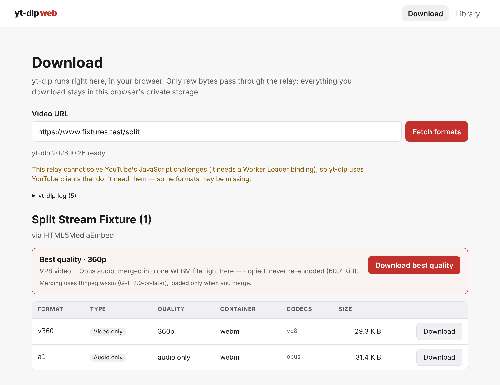

# yt-dlp-web

Run [yt-dlp](https://github.com/yt-dlp/yt-dlp) in your browser. The real, unmodified yt-dlp Python
package runs client-side in [Pyodide](https://pyodide.org). Downloads go into your browser's
private file system and show up in a local library, next to videos you import from your device.
A small Cloudflare Worker does the two things a web page is not allowed to do: relay bytes across
CORS, and run YouTube's JavaScript challenges in a network-severed sandbox. The Worker is
optional: without it, the app is a private library and animation maker for the videos you
already have.



## How it works

```
Browser (static app)
├─ page ─────────── Svelte UI, the library (IndexedDB metadata)
├─ engine worker ── Pyodide + yt-dlp ──sync XHR──▶ Worker /relay   (pages, APIs, player JS)
│                                      ──sync XHR──▶ Worker /solve   (JS challenges, sandboxed)
├─ download worker ─ ranged fetches through /relay ──▶ OPFS (resumable)
│                    files you import from your device ──▶ OPFS
├─ remux worker ─── FFmpeg (WebAssembly), only when you merge ──▶ OPFS
└─ animate worker ─ GIF, APNG, WebP, AVIF or JPEG XL, only while it makes one

Cloudflare Worker: holds no secrets, stores nothing, parses nothing
├─ /relay  one browser request → one upstream request, host allowlist, never follows redirects
└─ /solve  a Dynamic Worker isolate with no network and no bindings
```

- **yt-dlp itself decides everything**: which extractor, which formats, how to solve YouTube's
  challenges. Every browser-specific piece plugs into one of its own plugin seams: a
  `RequestHandler` for networking and a `JsChallengeProvider` for the challenges. yt-dlp is never
  patched.
- **Bulk media never goes through Python.** yt-dlp resolves the formats, and the download worker
  fetches the chosen one in ranged chunks into the origin-private file system (OPFS). You can
  pause, resume, play in the page, save to disk, or delete.
- **Muxed formats first.** Formats that hold both picture and sound download as they are. For
  the _best_ quality, which usually comes as separate video and audio streams, the page offers a
  merge. That merge is a stream copy with FFmpeg compiled to WebAssembly, never a re-encode, and
  FFmpeg is only loaded when you ask for one.
- **Videos you already have.** _Import videos…_ in the library copies files from your device into
  the same private storage, after the browser has opened each one as it will play it: they play,
  save back unchanged and animate like downloads. _Animate a video file…_ opens one straight from
  disk in the animation maker instead, copying nothing (that works without private storage, too).
  Nothing you import is uploaded anywhere.
- **Animated images from your videos.** Pick a stretch of any video in the library on a timeline,
  drag the crop handles over the picture, choose the format, frame rate and width, and the page
  makes a looping animation. The browser decodes the frames itself; a worker encodes them, with no
  FFmpeg needed:

  | Format  | Made by                                                      | Where                                    |
  | ------- | ------------------------------------------------------------ | ---------------------------------------- |
  | GIF     | the app's own encoder (256 colors, dithered)                 | every browser                            |
  | APNG    | the app's own encoder (lossless, zlib by the browser)        | every browser                            |
  | JPEG XL | the app's own encoder (lossless)                             | every browser; few can show it yet       |
  | WebP    | the browser's WebP encoder, frame by frame, muxed by the app | browsers whose canvas makes WebP         |
  | AVIF    | the browser's AV1 encoder (WebCodecs), muxed by the app      | browsers that encode AV1, such as Chrome |

  The page only offers what the browser in front of it can make.

Read on in [`docs/ARCHITECTURE.md`](docs/ARCHITECTURE.md).

## Security

- A strict Content Security Policy:
  - `script-src 'self' 'wasm-unsafe-eval'`, never `unsafe-eval`;
  - Trusted Types enforced;
  - `connect-src` limited to the app and its relay.
- Workers get their own policy wherever the host can send headers.
- The relay only reaches an allowlist of hosts. It never follows redirects itself, and its responses
  are inert even if a browser renders them.
- YouTube's player JavaScript runs only in a sandbox with no network, never in the app's origin.
- The pinned yt-dlp wheels are SHA-256-checked at every step, and nothing is fetched from a CDN,
  PyPI or micropip at runtime.
- Thumbnails come through the relay too, so no third-party host sees you browse your library.

Details, including what GitHub Pages cannot do, are in [`docs/SECURITY.md`](docs/SECURITY.md).

## Running it yourself

You need [Bun](https://bun.sh) and, for the relay, a Cloudflare account.

```bash
bun install
cp worker/.dev.vars.example worker/.dev.vars
bun run worker:dev                                   # the relay, on http://localhost:8787
VITE_RELAY_URL=http://localhost:8787 bun run dev     # the app, on http://localhost:5173
```

`bun run dev` and `bun run build` first fetch the pinned yt-dlp wheels (hash-checked) and copy them
into `static/`, along with Pyodide and FFmpeg (see below).

To deploy, see [`docs/SELF-HOSTING.md`](docs/SELF-HOSTING.md). It covers the layouts:

- a static host with security headers plus the Worker;
- the Worker serving everything from one origin;
- GitHub Pages plus the Worker (there is a workflow for it);
- any static host without the Worker: `VITE_RELAY_URL=none bun run build`. The app then fetches
  nothing from other sites and ships no Pyodide, wheels or FFmpeg; it imports, plays and animates
  the videos you already have. The GitHub Pages workflow builds this when no `RELAY_URL` is set.

`/solve` needs a paid Workers plan. Without it the app still works, with fewer YouTube formats. If
the Worker is switched off after a deploy, the download page says the relay isn't answering, and
the library keeps working.

For a quick look without the Worker:

```bash
VITE_RELAY_URL=none bun run dev                      # the app, on http://localhost:5173
```

By default the relay only reaches YouTube's hosts. yt-dlp can extract many more sites if you add
their hosts to the relay's `ALLOWED_HOSTS`, one by one.

## FFmpeg for merging

By default the app merges with [ffmpeg.wasm](https://github.com/ffmpegwasm/ffmpeg.wasm): a whole
FFmpeg, ~31 MiB of wasm, GPL-2.0-or-later. A merge only ever copies streams, so you can compile
FFmpeg for exactly that instead:

```bash
bun run build:ffmpeg                    # FFmpeg master (pinned commit) → .ffmpeg-build/dist/
YT_DLP_WEB_FFMPEG=remux bun run build   # ship it instead of ffmpeg.wasm
```

This remux core has every demuxer, muxer, parser and bitstream filter FFmpeg has, so it copies any
codec between any of the containers FFmpeg knows, and nothing else: no decoders, encoders, filters,
network or threads. It is ~2.5 MiB of wasm (1.1 MiB gzipped), LGPL-2.1-or-later, and small enough
for the all-in-one Worker layout. Since FFmpeg 6.0 the `ffmpeg` program needs threads, which a page
can only have with cross-origin isolation, so a small single-threaded program (`ffmpeg/remux.c`)
takes its place: the stream-copy subset of ffmpeg's command line, over FFmpeg's own libraries.

The command needs git, python3 and make. It installs the pinned Emscripten into `.ffmpeg-build/`
unless that release's `emcc` is already on your `PATH`. The same pins build the same bytes, and a
build whose inputs have not changed is kept. `FFMPEG_REF=master bun run build:ffmpeg` builds the
newest FFmpeg instead of the pinned commit.

## Tests

Red/green throughout, and hermetic by default: CI never touches YouTube or a deployed Worker.

| Command                                            | What runs                                                                                                                                                  |
| -------------------------------------------------- | ---------------------------------------------------------------------------------------------------------------------------------------------------------- |
| `bun run test`                                     | Vitest: units (jsdom), plus **real** Pyodide with the real pinned wheels, the real FFmpeg cores (the remux core once built) and the Worker in real workerd |
| `bun run test:e2e`                                 | Playwright against the built app and the real relay handler, with a fake video site upstream. Fails on any CSP or Trusted Types violation                  |
| `bun run test:browseros`                           | The same e2e suite in [BrowserOS](https://www.browseros.com): set `BROWSEROS_PATH` (launch it) or `BROWSEROS_CDP_URL` (attach to it). Skips otherwise      |
| `bun run test:docker`                              | Exactly what CI runs: format, audit, check, all of the above, e2e on Chromium, Firefox and WebKit, then on a build without a relay                         |
| `LIVE_APP_URL=… bunx playwright test --grep @live` | Real YouTube through a deployed app and relay                                                                                                              |

Also: `bun run check` (svelte-check + tsc), `bun run format:check`, `bun run audit`.

## Keeping yt-dlp current

yt-dlp and the yt-dlp-ejs solver move together; each yt-dlp release pins the exact solver it needs.
`bun run update:ytdlp` rewrites both pins from PyPI and verifies the downloads. A weekly workflow
fails when a newer yt-dlp is out.

## More

- [`docs/ARCHITECTURE.md`](docs/ARCHITECTURE.md) — how the pieces fit together.
- [`docs/SECURITY.md`](docs/SECURITY.md) — the threat model, the policies and the relay's limits.
- [`docs/SELF-HOSTING.md`](docs/SELF-HOSTING.md) — deploying the relay and the app.
- [`docs/THIRD-PARTY.md`](docs/THIRD-PARTY.md) — what the app ships, under which licenses
  (ffmpeg.wasm is GPL-2.0-or-later, the remux core LGPL-2.1-or-later; either can be left out).
- [`CLAUDE.md`](CLAUDE.md) — contributor conventions and the constraints behind non-obvious code.

Use it for content you have the right to download, and within the terms of the sites you use it
with.
